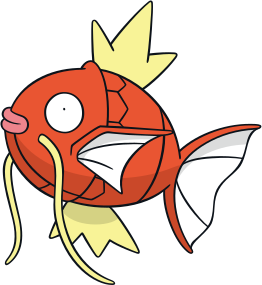

# 🐟 FishSaver — Magikarp Jump Restorative Aquarium

An interactive desktop aquarium and ecological simulation inspired by **Magikarp Jump**, blending **neuroevolution**, **Couzin schooling dynamics**, and **Attention Restoration Theory**. Works standalone in any browser or as an interactive live desktop wallpaper via [Lively Wallpaper](https://www.rocksdanister.com/lively/).



---

## ✨ Highlights

- **Articulated Vector Kinematics**: Mouth-leading swimming physics with independently animated SVG parts—unified caudal tail fin, pectoral fin, dorsal & ventral crowns, and trailing whiskers.
- **Rare Patterns & Shiny Variants**: Features Classic Orange, Calico, Two-Tone, Orca, Pink Orca, Tiger Stripes, Dapples, and ★ **Shiny Gold** with orbiting stars.
- **Neuroevolution & Ecological Balance**: Each Magikarp has an evolving neural network governing foraging, schooling, and energy management. Seabed flora and glass biofilm naturally sustain a carrying capacity of **~3–5 fish**, while healthy fish reproduce and pass on mutated weights.
- **Ambient Hydrodynamics & Soundscape**: Divergence-free 2D curl noise water currents, suspended marine snow, procedural optical caustics, and optional Web Audio API sub-surface hydroacoustics.
- **Soft Fascination HUD**: Minimal telemetry overlay that automatically fades out after 3.6 seconds of inactivity for a clean wallpaper experience.

---

## 🚀 Quick Start

### 1. Run with Local Node Server (Recommended)
Running the lightweight zero-dependency Node server automatically persists your highest-generation champion fish to [`highest_fish.json`](./highest_fish.json):

```bash
node server.js
```
*(Or double-click `run_aquarium.bat` on Windows — opens `http://localhost:3000/index.html`)*

### 2. Run Directly in Browser / Lively Wallpaper
Open [`index.html`](./index.html) directly in any modern browser, or drag-and-drop `index.html` (or the `http://localhost:3000` URL) into **Lively Wallpaper** to set it as an interactive desktop background.

---

## 🎮 Controls

| Input | Action |
| :--- | :--- |
| **Click / Tap Water** | Creates water ripples and triggers a natural C-start escape reflex |
| **`👑 Spawn Champion`** | Spawns your saved highest-generation Magikarp from `highest_fish.json` |
| **`🔈 Ambient Audio`** | Toggles procedural underwater swell and Minnaert bubble acoustics |
| **Move Mouse** | Reveals the live neural & ecological telemetry HUD |

---

## 📁 Project Structure

- [`index.html`](./index.html) — Complete aquarium simulation, canvas renderer, neural net, and Web Audio synth
- [`magikarp.svg`](./magikarp.svg) — Segmented vector artwork for articulated fin and body animation
- [`server.js`](./server.js) — Zero-dependency Node.js server for serving the app and saving `highest_fish.json`
- [`highest_fish.json`](./highest_fish.json) — Saved neural weights and generation record for the top champion fish
- [`run_aquarium.bat`](./run_aquarium.bat) — One-click Windows launcher
